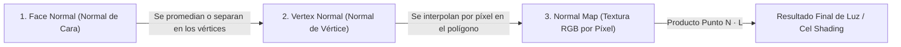
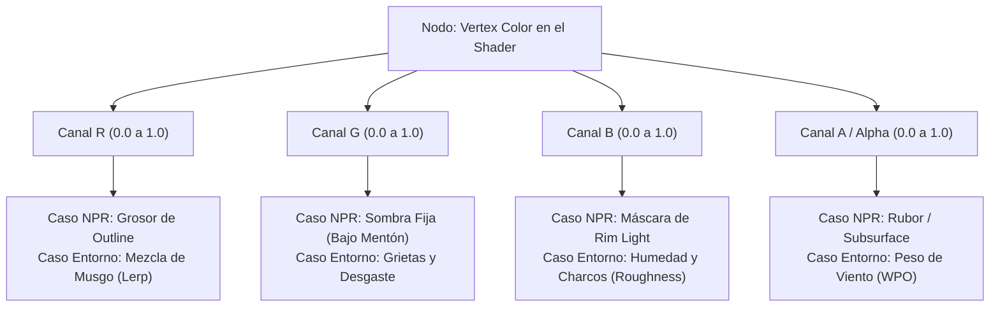
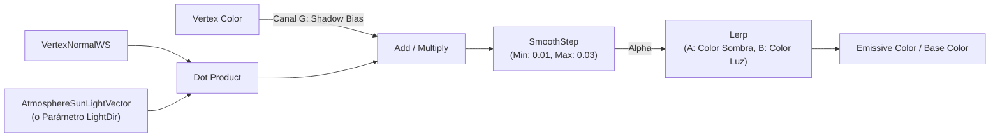

# NPR, Geometría de Normales y Vertex Color

**Unidad Técnica Especial — Sombreado No-Fotorrealista (NPR) y Arte Técnico para Videojuegos**  
**Docente:** Daniel Rojas · **Plataforma:** Unreal Engine 5 / Unity / Motores 3D y 2D

---

## 1. De la Física PBR a la Estilización NPR: La Ecuación del Producto Punto

Tanto un motor hiperrealista (como *The Last of Us* o *Alan Wake 2*) como un juego de estética anime o cómic (*Guilty Gear Strive*, *Genshin Impact*, *Hi-Fi Rush*, *Zelda: Breath of the Wild*) parten exactamente de la misma operación matemática para saber cuánta luz recibe un punto de un modelo: el **Producto Punto (Dot Product)** entre el **Vector Normal de la superficie ($\vec{N}$)** y el **Vector de Dirección de la Luz ($\vec{L}$)**:

$$\text{Iluminación Base} = \vec{N} \cdot \vec{L} = |\vec{N}| \, |\vec{L}| \cos(\theta)$$

* Si la superficie apunta directamente hacia la luz ($\theta = 0^\circ$), el producto punto vale **$+1.0$** (luz máxima).
* Si la superficie está a $90^\circ$ respecto a la luz, el producto punto vale **$0.0$** (el *Terminator* o frontera de sombra).
* Si la superficie da la espalda a la luz ($\theta > 90^\circ$), el producto punto cae hacia **$-1.0$** (sombra).

La diferencia fundamental entre el **PBR (Physically Based Rendering)** y el **NPR (Non-Photorealistic Rendering)** es qué hacemos con ese número continuo entre $-1.0$ y $+1.0$:
1. **En PBR:** Mantenemos el degradado suave continuo (`saturate(dot(N, L))`), permitiendo que la luz decaiga orgánicamente siguiendo la ley del coseno de Lambert.
2. **En NPR (Cel Shading / Toon):** Rompemos el degradado continuo pasando el valor $\vec{N} \cdot \vec{L}$ por una función escalonada (`Step`, `Smoothstep` estrecho o una textura **Color Ramp 1D**), convirtiendo la transición suave en bloques sólidos de luz y sombra con bordes nítidos, y reemplazando las sombras negras por colores saturados (violetas, azules fríos o corales cálidos).

<ClientOnly>
  <ToonRampViewer />
</ClientOnly>

---

## 2. Anatomía de las Normales: Face Normal vs. Vertex Normal

Si toda la iluminación depende de $\vec{N} \cdot \vec{L}$, **quien controla el vector Normal ($\vec{N}$) controla dónde cae la luz y qué forma tiene la sombra**. En una malla poligonal 3D existen tres niveles distintos de normales que todo artista técnico debe dominar:

### 2.1. Face Normal (Normal de Cara o Polígono)
Es el vector perpendicular real y físico de cada triángulo individual. Se calcula mediante el producto cruz de dos de sus aristas:

$$\vec{N}_{\text{face}} = \text{normalize}\big((\vec{V}_2 - \vec{V}_1) \times (\vec{V}_3 - \vec{V}_1)\big)$$

* **Comportamiento:** Existe **una sola Face Normal por polígono**. Todos los puntos dentro de ese triángulo miran exactamente en la misma dirección matemática.
* **Resultado visual:** Si el motor ilumina usando *Face Normals* puras, cada cara tiene un color plano uniforme y el cambio entre un polígono y el vecino es un salto brusco (**Flat Shading** o estética *Low-Poly* facetada).

### 2.2. Vertex Normal (Normal de Vértice)
Los videojuegos necesitan representar cabezas humanas, esferas, carrocerías y cilindros suaves usando pocos miles de triángulos planos. Para engañar al ojo sin subdividir el modelo en millones de polígonos, las tarjetas gráficas guardan vectores normales **en los vértices**, no en las caras.

* **Interpolación Baricéntrica en el Pixel Shader:** Cuando un triángulo tiene tres vértices ($A, B, C$) con tres *Vertex Normals* apuntando en direcciones ligeramente distintas, la GPU **interpola suavemente** la dirección de la normal píxel por píxel a lo largo del interior del triángulo.
* **El truco óptico:** Aunque el triángulo sigue siendo geométricamente plano como una tabla, el cálculo $\vec{N} \cdot \vec{L}$ varía gradualmente de un extremo al otro, haciendo que la luz se curve como si fuera una superficie esférica perfecta.

### 2.3. Hard Edges (Split Normals) vs. Soft Edges (Smooth Normals)
Cuando modelas en Blender, Maya o 3ds Max y eliges entre **Shade Smooth (Suavizado)** y **Shade Flat / Mark Sharp (Borde Duro)**, no estás moviendo ningún vértice de lugar; estás cambiando únicamente sus **Vertex Normals**:

| Propiedad Técnica | Soft Edge (Smooth Vertex Normals) | Hard Edge (Split Vertex Normals) |
| :--- | :--- | :--- |
| **Dirección del Vector en la Esquina** | Las caras vecinas **promedian** sus direcciones en **1 sola Vertex Normal compartida**. | Cada cara impone su propia dirección: el vértice tiene **2, 3 o más Vertex Normals separadas**. |
| **Comportamiento de la Luz** | La luz fluye sin cortes a través de la arista, ocultando la esquina poligonal. | La luz se corta en seco en la arista, marcando un bisel mecánico o esquina dura. |
| **Impacto en Memoria de GPU (Vertex Buffer)** | **Óptimo (1 vértice en GPU):** Como las caras comparten posición y normal, el motor envía un único vértice. | **Mayor costo (Vértices duplicados):** Una GPU no puede asignar dos normales a un mismo índice; un cubo con *Hard Edges* pasa de 8 vértices en Maya a **24 vértices reales** en Unreal Engine ($8 \times 3$ caras). |

---

## 3. El Secreto del NPR Moderno: Normal Transfer e Inverted Hull

En el sombreado realista (PBR), una pequeña desviación en una *Vertex Normal* apenas produce una variación de gris imperceptible. En cambio, en el **Cel Shading (NPR)** usamos un corte binario (`Step`): si $\vec{N} \cdot \vec{L}$ baja un milímetro por debajo del umbral (por ejemplo, de $0.01$ a $-0.01$), **el píxel salta instantáneamente de blanco iluminado a sombra oscura**.

Esto genera los dos problemas más famosos del arte 3D estilizado, y sus respectivas soluciones de industria:

### 3.1. Problema 1: El Rostro "Sucio" en Cel Shading y la Técnica de Normal Transfer (Esfera Proxy)
Cuando modelamos la cara de un personaje 3D con buena topología (cuencas de ojos, puente de la nariz, surco nasogeniano, labios y pómulos), las *Vertex Normals* automáticas siguen fielmente cada pequeño hundimiento de la malla.
* **El fallo:** Al aplicar un shader Toon (`Step`), aparecen sombras triangulares rotas en las mejillas, cortes dentados bajo la nariz y manchas oscuras alrededor de la boca cuando la luz gira. El personaje parece una estatua de plástico mal iluminada en lugar de una ilustración 2D.
* **La solución de la industria (*Guilty Gear*, *Genshin Impact*, *Dragon Ball FighterZ*):** En el dibujado de anime tradicional 2D, los animadores sombrean la cabeza como si fuera un **huevo o esfera simple**, ignorando las micro-arrugas de la mejilla. En 3D logramos exactamente lo mismo mediante **Transferencia de Normales (Normal Transfer / Data Transfer)**:
  1. Se crea una **esfera o cápsula limpia (Proxy Mesh)** envolviendo la cara del personaje.
  2. Se transfieren las direcciones de las *Vertex Normals* de esa esfera hacia los vértices del rostro.
  3. **Resultado:** El modelo conserva el 100% de sus vértices reales (la nariz sigue sobresaliendo en silueta y la boca puede abrirse), pero para el shader de luz la cara reacciona matemáticamente como un elipsoide liso, proyectando una línea de sombra curva e impecable de oreja a mentón.

### 3.2. Problema 2: El Contorno 3D (*Inverted Hull Outline*) y la Rotura de Esquinas
La técnica estándar en videojuegos para dibujar líneas de tinta negra alrededor de un modelo 3D se llama **Inverted Hull (Casco Invertido)**:
1. Se dibuja una segunda pasada del mismo modelo pintada de negro (`Unlit`).
2. Se invierte el *Culling* de cámara (`Cull Front` / mostrar solo caras traseras).
3. En el *Vertex Shader*, cada vértice se infla hacia afuera empujándolo en la dirección de su **Vertex Normal**:

$$\vec{P}_{\text{outline}} = \vec{P}_{\text{original}} + (\vec{N}_{\text{vertex}} \times \text{Grosor})$$

* **Por qué se rompe en bordes duros (*Hard Edges*):** Si tienes un cubo, cilindro o espada con *Hard Edges*, en cada esquina hay 3 vértices duplicados cuyas *Vertex Normals* apuntan a $90^\circ$ de distancia entre sí. Al empujar cada cara hacia su propia normal, **las caras extruidas se separan dejando un hueco vacío en la esquina** y el contorno negro queda partido.
* **Cómo se repara en producción:** Se guarda una copia **100% suavizada (Soft/Smooth)** de las normales (en las normales principales si el objeto usa Normal Map compensado, o en un canal secundario UV / Vertex Color) exclusivamente para que el *Vertex Shader* del contorno infle los vértices unidos sin abrir brechas.

### 3.3. Laboratorio Interactivo 01: Simulador de Normales, Normal Transfer e Inverted Hull

Experimenta en tiempo real con el **Rostro Estilizado**, el **Cilindro Biselado** y la **Esfera Facetada**. Usa los tres botones de **Casos de Estudio** superiores para comparar instantáneamente un Cel Shading roto por topología, un *Normal Transfer* limpio estilo anime y un *Inverted Hull Outline* abierto en las esquinas frente a uno sellado:

<ClientOnly>
  <NPRNormalsViewer />
</ClientOnly>

---

## 4. Diferencia entre Vertex Normals, Normal Map (Textura) y Normales 2D

Un error conceptual frecuente es confundir las **normales de la geometría** con el **Normal Map de textura**. La siguiente tabla resume cómo interactúan ambos sistemas en proyectos 3D y 2D:

| Sistema | Dónde vive el dato | Resolución | Qué modifica realmente | Uso clave en Entrega 3 y Examen |
| :--- | :--- | :--- | :--- | :--- |
| **Face Normal** | En el triángulo (calculada por sus 3 vértices). | 1 vector por polígono. | Da la orientación plana bruta de cada cara. | Estética *Low-Poly* facetada intencional o diagnóstico de caras invertidas (*Backfaces*). |
| **Vertex Normal** | Guardada en cada vértice del *Vertex Buffer*. | 1 vector por esquina de vértice. | Controla el suavizado macro de la malla y la dirección hacia donde crece el **Inverted Hull Outline**. | **Fundamental en NPR 3D:** Limpiar sombras en rostros (*Normal Transfer*) y sellar contornos. |
| **Normal Map (Tangent Space)** | En una textura de imagen RGB (`#8080FF`). | Millones de vectores (1 por cada píxel/texel UV). | Perturba la *Vertex Normal* píxel por píxel para fingir poros, tornillos o ladrillos sin añadir polígonos. | Detalle de superficie en 3D, o **trazos de pincel pintados en las normales** (estilo *Arcane* / *Into the Spider-Verse*). |
| **Normal Map en Sprites 2D** | Textura RGB secundaria emparejada al Sprite 2D. | 1 vector por píxel del Sprite. | Como un `Quad` 2D es totalmente plano ($\vec{N} = (0,0,1)$), el Normal Map le inventa volumen esférico o biselado para reaccionar a luces dinámicas `Point`/`Spot`. | **Obligatorio en juegos 2D / HD-2D:** Permite que antorchas y hechizos iluminen el borde derecho o izquierdo de un personaje 2D (*Octopath Traveler*, *Dead Cells*). |

---

## 5. Vertex Color: Pintura en Vértices y Empaquetado de 4 Máscaras (RGBA)

El **Vertex Color (Color de Vértice)** es un atributo adicional guardado directamente dentro de cada vértice de la malla 3D, compuesto por cuatro valores flotantes entre $0.0$ y $1.0$:

$$\text{Vertex Color} = \text{vec4}(R, G, B, A)$$

Al igual que ocurre con las *Vertex Normals*, la tarjeta gráfica **interpola gratuitamente** el color entre un vértice y sus vecinos a través de la superficie del triángulo. Su gran ventaja técnica es que **no consume memoria de texturas adicional (0 MB de VRAM en imágenes)** ni depende de que los UVs estén desplegados sin solapamientos.

En la industria de los videojuegos, el *Vertex Color* se utiliza de dos maneras radicalmente distintas: **Uso Artístico Directo** y **Uso Técnico como 4 Máscaras de Datos**.

### 5.1. Uso 1: Vertex Color Artístico (Color Visible y Ambient Occlusion en Vértices)
Es el uso clásico donde el color pintado en los vértices se conecta directamente al **Base Color (Albedo)** del material o se multiplica sobre él:
* **Estética Low-Poly y Estilizada (*Journey*, *Abzû*, *Monument Valley*, *Tunic*):** Modelos sin texturas de imagen donde toda la paleta cromática y los degradados suaves entre la base y la punta de una estructura provienen de los vértices.
* **Baked Vertex Ambient Occlusion (AO):** Se hornea la oclusión ambiental en escala de grises dentro de los vértices (negro $0.0$ en grietas profundas e interiores de ropa; blanco $1.0$ en zonas expuestas) y se multiplica (`Multiply`) por el color base o la luz ambiental para asentar el modelo sin coste de rendimiento en tiempo real.

### 5.2. Uso 2: Empaquetado de 4 Máscaras Técnicas Independientes (R, G, B, A)
Si abres el modelo 3D de un personaje de *Guilty Gear Strive* o un edificio modular de *The Last of Us* o *God of War* en Blender/Maya y activas la vista de *Vertex Color*, verás que el modelo está pintado con un **aspecto de arcoíris técnico (zonas rojas puras, verdes fluorescentes, azules y amarillas)**.

¿Por qué se ve así? Porque el shader **jamás muestra ese color en pantalla**. En lugar de usar $(R, G, B, A)$ como un color decorativo, el artista técnico separa los 4 canales en el editor de materiales para tener **4 mapas de control en blanco y negro ($0.0 = 0\%$, $1.0 = 100\%$)** dentro del mismo modelo:

#### Aplicación A: Personajes NPR y Cel Shading (Estilo *Guilty Gear* / *Genshin Impact*)
En un personaje estilizado, la matemática pura de la luz no siempre toma buenas decisiones artísticas. Usando los 4 canales de *Vertex Color*, el artista dirige la iluminación vértice por vértice:
1. **Canal Rojo (`VertexColor.R`) — Control de Grosor del Outline:** Se multiplica por el desplazamiento del *Inverted Hull*:
   $$\text{Desplazamiento} = \vec{N}_{\text{vertex}} \times \text{GrosorMáximo} \times \text{VertexColor.R}$$
   * Donde el artista pinta **Blanco ($R = 1.0$)** (silueta exterior de hombros, cabello, botas), el trazo de tinta tiene el $100\%$ de su grosor.
   * Donde pinta **Gris o Negro ($R = 0.0 \text{ a } 0.2$)** (punta de la nariz, labios, párpados, dedos), la línea se adelgaza o desaparece para evitar manchones negros toscos dentro de la cara.
2. **Canal Verde (`VertexColor.G`) — Umbral de Sombra Permanente (Shadow Bias):** Se suma o multiplica al producto punto $\vec{N} \cdot \vec{L}$ antes del `Step`:
   * Bajo la barbilla, en el cuello alto, dentro de las orejas y bajo los mechones del flequillo se pinta **Negro ($G = 0.0$)**. Así, aunque el sol apunte directamente de frente, esas zonas permanecen siempre en sombra estilizada, garantizando lectura de volumen en cualquier plano de cámara.
3. **Canal Azul (`VertexColor.B`) — Máscara de Rim Light / Specular:** Multiplica el efecto `Fresnel` para permitir que el recorte de luz brillante aparezca en el contorno superior del cabello y hombros ($B = 1.0$), pero bloqueándolo en zonas internas como axilas o entrepierna ($B = 0.0$).
4. **Canal Alfa (`VertexColor.A`) — Subsurface / Tinte Cálido Interior:** Añade rubor o dispersión rojiza en mejillas, nariz y orejas en la frontera entre luz y sombra.

#### Aplicación B: Entornos 3D (*Environment Blending* y Animación por Vértices WPO)
En escenarios grandes, crear una textura única para cada muro o columna agotaría la memoria de video. En su lugar, se instancia **el mismo pilar 20 veces** con un *Master Material* y se pinta *Vertex Color* directamente dentro de Unreal Engine (*Mesh Paint Mode*):
1. **Canal Rojo (`VertexColor.R`):** Conecta al pin `Alpha` de un nodo `Lerp` para mezclar el material base (Piedra/Ladrillo) con una segunda capa (Musgo, Nieve o Arena).
2. **Canal Verde (`VertexColor.G`):** Conecta a un segundo `Lerp` para revelar yeso roto, ladrillo expuesto o suciedad en las esquinas.
3. **Canal Azul (`VertexColor.B`):** Controla la humedad y charcos de agua: oscurece el *Albedo* y reduce simultáneamente el *Roughness* a $0.05$ para crear reflejos especulares de agua estancada.
4. **Canal Alfa (`VertexColor.A`) — Peso de Animación de Viento (*World Position Offset*):** Cuando animamos pasto, hojas o telas mediante ondas sinusoidales en el *Vertex Shader*, si movemos todos los vértices por igual, **la planta entera se despegará flotando del suelo o de la pared**. Pintando `Alpha = 0.0` (negro) en la base/raíz y `Alpha = 1.0` (blanco) en las puntas, la base queda anclada con firmeza ($\text{Viento} \times 0 = 0$) mientras las puntas oscilan libremente.

### 5.3. Laboratorio Interactivo 02: Simulador de Vertex Color y Máscaras RGBA

Alterna entre el **Caso A (Personaje NPR)** y el **Caso B (Entorno 3D con Viento WPO)**. Utiliza la barra **Vista de Diagnóstico** para inspeccionar el mapa `Vertex Color RGB (Raw)` (el aspecto "arcoíris" de producción) y cada uno de los 4 canales en escala de grises (`R`, `G`, `B`, `A`), ajustando su influencia con los controles deslizantes:

<ClientOnly>
  <VertexColorViewer />
</ClientOnly>

---

## 6. Guía de Implementación Paso a Paso (Blender a Unreal Engine 5)

Para aplicar estas técnicas en tu **Entrega N°3 (Avance LookDev / Prototipo NPR)** y en el **Examen Final**, sigue este flujo de producción estándar:

### Paso 1: Preparar y Transferir Normales en Blender (Para Cel Shading Limpio)
1. **Activar visualización de normales:** Selecciona tu malla en *Edit Mode*, abre el menú **Viewport Overlays** (esquina superior derecha) y activa los iconos de **Display Face Normals** (líneas celestes desde el centro de cada cara) y **Display Split Normals / Vertex Normals** (líneas rosadas desde cada vértice).
2. **Crear la malla Proxy para el rostro:** Crea una `UV Sphere` o `Cylinder` suavizado (`Shade Smooth`), escálalo para que envuelva la zona facial de tu personaje y ocúltalo del render.
3. **Aplicar el modificador Data Transfer:**
   * Selecciona la malla de tu personaje y añade el modificador **Data Transfer**.
   * En **Source**, selecciona tu esfera proxy.
   * Si solo quieres afectar la cara y no el resto del cuerpo, crea un **Vertex Group** llamado `Rostro` y asígnalo en el campo *Vertex Group* del modificador.
   * Marca la casilla **Face Corner Data**, despliega sus opciones, activa el botón **Custom Normals** y deja el método en *Nearest Face Interpolated* o *Projected Face Interpolated*.

### Paso 2: Pintar Canales RGBA de Vertex Color en Blender
1. Cambia del modo *Object Mode* al modo **Vertex Paint** (`Ctrl + Tab`).
2. En el panel **Data (icono de triángulo verde)** -> **Color Attributes**, verifica que exista un atributo de color (por defecto llamado `Color` o `Col`) en dominio **Vertex** o **Face Corner** con formato **Byte Color**.
3. Para pintar canales puros sin contaminar los demás:
   * Usa color **Negro puro (`0, 0, 0`)** como base si quieres iniciar todas las máscaras apagadas, o **Blanco (`1, 1, 1`)** si quieres iniciar todo al $100\%$.
   * En las opciones de tu pincel (*Blend Mode*), puedes usar **Mix** con colores primarios puros: Rojo `(1, 0, 0)` para subir el Canal R, Verde `(0, 1, 0)` para el Canal G y Azul `(0, 0, 1)` para el Canal B.

### Paso 3: Importación Correcta en Unreal Engine 5 (Crítico)
Cuando exportes tu archivo `.FBX` desde Blender o Maya e importes el modelo en Unreal Engine 5, **el motor intentará recalcular las normales automáticamente por defecto, destruyendo tu Normal Transfer**. Para evitarlo:
1. En la ventana **FBX Import Options** de Unreal Engine, busca la sección **Mesh**.
2. Cambia **Normal Import Method** a: `Import Normals and Tangents` (nunca lo dejes en *Compute Normals*).
3. Cambia **Vertex Color Import Option** a: `Replace` (para que Unreal importe los colores RGBA que pintaste en Blender/Maya; por defecto suele venir en *Ignore*).

### Paso 4: Conexión en el Material Editor de Unreal Engine 5

* **Para el Cel Shading + Canal G (Sombra Forzada):**
  * Crea el nodo `VertexNormalWS` y conéctalo a un nodo `Dot` junto con `SkyAtmosphereLightDirection` (o un `CollectionParameter` con la dirección de tu luz principal).
  * Añade el nodo `Vertex Color`, toma su salida **G (Verde)**, réstale $1.0$ (para que donde pintaste negro valga $-1.0$ y donde pintaste blanco valga $0.0$) y súmalo al resultado del `Dot`.
  * Pasa el resultado al pin `Value` de un nodo `SmoothStep` (con `Min = 0.0` y `Max = 0.02`) y úsalo como `Alpha` de un `Lerp` entre tu color de sombra y tu color iluminado.
* **Para el Inverted Hull Outline + Canal R (Grosor Variable) o Viento + Canal A:**
  * Multiplica `VertexNormalWS` $\times$ `Parametro_Grosor` $\times$ `Vertex Color (Canal R)` y conéctalo al pin **World Position Offset** de tu material de contorno.
  * Para vegetación, multiplica tu nodo `SimpleGrassWind` (o función `Sine`) por `Vertex Color (Canal A)` antes de conectarlo a **World Position Offset**, garantizando que las raíces pintadas de negro permanezcan ancladas al suelo.

---

## 7. Referencias Vinculadas en la Plataforma

* [Rúbrica Entrega N°3: Avance de Examen — LookDev, NPR y Banco de Pruebas](/clases/rubrica-entrega-03)
* [Rúbrica Examen Final: Integración en Videojuego y Breakdown Técnico (80.lv)](/clases/rubrica-examen)
* [04. Matemáticas de Shaders: Producto Punto, Fresnel, Lerp y Normales](/shaders/04-matematicas-shaders)
* [03. Modelos de Sombreado (Default Lit, Unlit, Subsurface, Foliage)](/shaders/03-shading-models)
